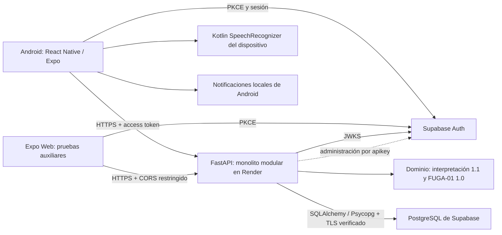

# Auditoría técnica de FUGA+

**Fecha:** 2026-11-18, America/Bogota.  
**Versión:** 1.0. Diagnóstico del árbol de trabajo local; no equivale a aceptación funcional ni a certificación de producción.  
**Base Git observada:** rama `develop`, HEAD `dd41fcb`, con cambios previos y numerosos archivos sin seguimiento.  
**Documento complementario:** [Plan de mejora](plan-mejora-fugaplus.md).

## 1. Resumen ejecutivo

FUGA+ dispone de una arquitectura adecuada para su alcance académico: aplicación React Native/Expo/TypeScript, monolito modular FastAPI, PostgreSQL en Supabase y autenticación delegada en Supabase Auth. Conviene conservarla. No se justifica incorporar microservicios, Redis, Kubernetes, Docker como requisito del MVP ni servicios de IA generativa.

Existe implementación conectada para acceso, interpretación determinista, confirmación, historial, edición y eliminación lógica, estadísticas, detección FUGA-01 y evidencia. La normalización 1.1 se comparte entre interpretación y análisis del historial; los parámetros de FUGA-01 siguen en versión 1.0. Hay ampliaciones de perfil, administración, imágenes, voz y notificaciones, cuya existencia no demuestra validación completa en dispositivos o proveedores.

Se identifican **14 hallazgos: 1 P0, 11 P1 y 2 P2**. El P0 es funcional: el plugin de imágenes bloquea el permiso de micrófono que necesita la voz Android. No se confirmó una vulnerabilidad explotable P0. Otras prioridades son obtener una compilación Android verificable, cerrar pruebas de integración y aceptación, preparar configuración de despliegue y resolver la incompatibilidad prevista entre el timeout del cliente y el arranque tras suspensión de Render Free.

Resultados reproducidos en esta auditoría: **255 pruebas backend aprobadas, 14 omitidas; 44 pruebas frontend aprobadas; TypeScript correcto; mypy correcto en 13 archivos de dominio**. Ruff encuentra **210 avisos** en su configuración completa, pero ninguno en F/E9/I. No se midió cobertura ni rendimiento y no se consultó Supabase real. Los resultados anteriores comunicados por la propietaria sobre conexión, esquema y semillas se consideran antecedentes, no mediciones repetidas aquí.

La siguiente intervención mínima recomendada es corregir únicamente la configuración que elimina `RECORD_AUDIO`, comprobar el manifiesto Android resultante y validar el flujo de voz en una compilación propia. La publicación deberá esperar a las condiciones de salida del plan.

## 2. Alcance, fuentes y límites

### 2.1. Prompt utilizado y discrepancias de entrada

La ruta solicitada `mi-framework-ia/docs/prompts/prompt-01-auditoria-plan-mejora-v1.md` **no existe**. Se leyó completo el archivo disponible [prompt-auditoria-tecnica-v1.md](../prompts/prompt-auditoria-tecnica-v1.md), de 462 líneas, cuyo título, versión y rutas de salida corresponden al encargo. El archivo termina abruptamente en el apartado 11, después de «Leer código». No se reconstruyeron instrucciones ausentes.

Se respetó la instrucción expresa de crear únicamente estos dos documentos. No se modificaron código, migraciones, dependencias, configuraciones, credenciales ni registros. No se iniciaron servicios, compilaciones, despliegues, commits o pushes.

### 2.2. Fuente funcional y prioridad de entrega

Las fuentes vigentes presentes son [REQUERIMIENTOS.md 3.0](../requerimientos/REQUERIMIENTOS.md) y [HISTORIAS_DE_USUARIO.md 3.0](../historias-usuario/HISTORIAS_DE_USUARIO.md), ambas con decisiones D-01 a D-15. Los archivos v2 mencionados en conversaciones anteriores no aparecen en el inventario actual.

La especificación define 13 historias Must Have: HU-01, HU-02, HU-04, HU-10, HU-11, HU-12, HU-13, HU-14, HU-20, HU-21, HU-23, HU-24 y HU-33. Voz HU-17/18/19 y notificaciones HU-25 continúan como Could Have. El prompt actual solicita priorizar la voz para la entrega Android: este informe la trata como **prioridad adicional de entrega**, sin modificar la clasificación documental ni los contratos. Notificaciones, Google, fotos y administración no deben retrasar el núcleo salvo decisión explícita de incluirlos.

### 2.3. Límites de comprobación

- No se leyeron valores de `.env.local`; no se certifica su configuración efectiva ni la del panel de Supabase o Render.
- No se efectuaron llamadas a Supabase, Cloudinary o cuentas reales ni consultas al esquema remoto.
- No se reejecutaron migraciones, semillas ni pruebas que crean bases de datos, aunque el fixture limite estas a PostgreSQL local.
- Las referencias a tablas, políticas y restricciones corresponden a los SQL locales. El estado remoto actual requiere evidencia independiente.
- No se ejecutaron pruebas de carga, ataques, auditoría binaria de APK ni validaciones reales de voz, correo o notificaciones.
- Se consultó documentación pública oficial para revisar viabilidad y límites de infraestructura. Las cuotas pueden cambiar y deben verificarse al desplegar.
- Los escaneos de secretos fueron heurísticos sobre archivos actuales rastreados y fuentes del cliente; no se inspeccionó exhaustivamente todo el historial Git ni artefactos binarios.

## 3. Metodología y herramientas

Se inventariaron fuentes, rutas, manifiestos, modelos Pydantic, SQL, pruebas, configuración de herramientas y documentación. Se compararon decisiones funcionales con flujos reales; se ejecutaron verificaciones locales aisladas y se identificaron por separado defectos comprobados, brechas de evidencia y riesgos condicionados.

La ejecución de Pytest se aisló mediante un lanzador temporal por entrada estándar: entorno de prueba sin secretos, lectura dotenv deshabilitada, HTTP externo y conexiones reales PostgreSQL bloqueadas. Las conexiones loopback necesarias para TestClient de Windows permanecieron disponibles. El lanzador no se incorporó al proyecto. Se usó `python -B` y se deshabilitó la caché de Pytest. No se ejecutó el smoke web porque escribe capturas y requiere un servidor.

| Herramienta | Situación observada | Resultado o recomendación |
|---|---|---|
| Python / Node | 3.12.6 / 24.16.0 instalados | Compatibles con las restricciones locales declaradas |
| Pytest | 9.2.0, pruebas de dominio, API, seguridad e integración | 255 aprobadas; 14 de integración omitidas |
| Pruebas frontend | `node --test tests/*.test.cjs` | 44 aprobadas; no son pruebas de componentes React ni E2E Android |
| TypeScript | 6.0.3; `strict` y `noUncheckedIndexedAccess` | `npm run typecheck`, salida 0 |
| mypy | 1.20.2; dominio con funciones tipadas | Sin incidencias en 13 archivos; sin caché incremental |
| Ruff | 0.3.7, configurado en `backend/pyproject.toml` | 210 avisos completos; F/E9/I: 0 |
| ESLint | No declarado, sin configuración y no instalado | Incorporación futura acotada si se aprueba; no se ejecutó |
| Pylint / Flake8 | No declarados ni instalados | Conservar Ruff como herramienta Python existente; no añadir linters redundantes |
| Cobertura | Sin configuración observada ni `pytest-cov` instalado | No existe porcentaje comprobado; definir medición dirigida al dominio y seguridad |
| pip-audit | 2.10.1 instalado | Reporte almacenado con 0 dependencias vulnerables; no es una consulta nueva de avisos |
| Auditoría npm | Reporte JSON almacenado con 0 vulnerabilidades | No se actualizó contra el registro durante esta auditoría |
| Android | Java y javac disponibles; ADB fuera de PATH y SDK ausente de su ubicación habitual | No demuestra ausencia en todas las ubicaciones; falta localizar/preparar toolchain |
| GitHub Actions | Sin `.github/workflows` | Los YAML de `mi-framework-ia` no constituyen CI/CD de FUGA+ |

Advertencia backend: una deprecación de Starlette sobre TestClient/httpx. No produjo fallos; no autoriza una sustitución automática de dependencias.

Distribución Ruff: B008: 54; E501: 28; S608: 3; UP035: 16; UP006: 38; S324: 1; UP007: 61; N818: 1; UP038: 2; B904: 1; UP017: 4; B017: 1. Deben revisarse antes de convertirlos en bloqueos: `Depends` de FastAPI explica parte de B008; SQL construido con fragmentos internos permitidos no prueba inyección; S324 requiere revisar el protocolo de firma de imágenes. No hay fundamento para afirmar 210 defectos de seguridad.

## 4. Tecnologías y estructura reales

| Componente | Versiones instaladas verificadas | Evidencia |
|---|---|---|
| App | Expo 58.0.25, React 19.3.0, React Native 0.88.1 | `mobile/package.json`, lock e instalaciones |
| Cliente Auth | `@supabase/supabase-js` 2.119.0 | `mobile/node_modules` y lock |
| Notificaciones / sesión nativa | `expo-notifications` 58.1.9 / `expo-secure-store` 58.0.3 | Manifiesto y paquetes |
| API | FastAPI 0.163.1, Starlette 1.10.0, Uvicorn 0.30.6 | Metadatos del entorno y `requirements.lock` |
| Validación | Pydantic 2.14.3, pydantic-settings 2.16.3 | Metadatos del entorno |
| Persistencia | SQLAlchemy 2.1.8, Psycopg 3.3.9 | SQL parametrizado y pool de sesiones |
| JWT / HTTP | PyJWT 2.15.1 / httpx 0.28.1 | Verificación JWKS e integraciones |
| Voz | Módulo Expo local Kotlin con `SpeechRecognizer` | `mobile/modules/fuga-voice` |
| PostgreSQL | Motor objetivo en Supabase; versión remota no consultada | Nueve migraciones SQL y fixture local |

Diez dependencias declaradas que tienen referencia en `expo/bundledNativeModules.json` satisfacen los rangos del SDK instalado. No se deduce de ello que Kotlin compile ni que el teléfono esté validado.

```text
mobile/
  App.tsx                 acceso y navegación por estado
  src/auth/               sesión y callbacks PKCE
  src/screens/            acceso, gastos, historial, dashboard, fugas, perfil, administración
  src/components/         interfaz reutilizable y ExpenseForm
  src/lib/                cliente API, Auth, tipos, validación, notificaciones
  src/voice/              adaptación del módulo nativo
  modules/fuga-voice/      Kotlin y manifiesto de micrófono
  tests/                  reglas y callbacks, sin renderizado React
backend/
  app/api/v1/             rutas y autorización
  app/core/               configuración, seguridad, errores y logs
  app/domain/             interpretación, normalización, estadísticas y FUGA-01
  app/services/           orquestación e integraciones
  app/repositories/       persistencia; también hay SQL en rutas y servicios
  app/schemas/            contratos Pydantic, no modelos ORM de tablas
  app/db/                 engine, pool y sesiones
  tests/                  unidad, API, seguridad e integración
supabase/                 migraciones 0001–0009, semillas y verificaciones SQL
mi-framework-ia/           documentación y framework auxiliar; no es el runtime financiero
```

Los YAML auxiliares declaran un proveedor LLM para el framework, pero no se encontró una integración de ese framework en el flujo financiero auditado. No se considera evidencia de que los gastos se envíen a IA generativa.

## 5. Resultados de calidad y estado funcional

### 5.1. Frontend

Hay reutilización de controles, formulario y cliente API centralizado. La sesión se elimina visualmente antes del cierre remoto; Android utiliza SecureStore fragmentado y Web utiliza localStorage para compartir estado PKCE entre pestañas del mismo navegador. Se valida monto entero, longitud, fecha y categoría antes de confirmar.

Las pantallas mezclan consulta, manejo de estado y representación, con abundantes líneas comprimidas y estilos inline. La navegación por estado es suficiente para pocas pantallas; no se justifica sustituirla ahora. Faltan pruebas del ciclo de vida de componentes, cambios de cuenta, errores de red, solicitudes concurrentes y módulos nativos. No existe funcionamiento financiero offline implementado.

### 5.2. Backend

El dominio está separado y probado. Los contratos prohíben campos adicionales en la confirmación de gastos y mantienen controles estrictos de dinero, fechas y versiones. Los repositorios filtran propietario, parametrizan valores, manejan cursor y exclusión lógica. Se preservan idempotencia y respuesta original del intento, incluso tras edición o borrado lógico.

La separación por capas es parcial: `admin.py` y `me.py` contienen SQL e integraciones; servicios de estadísticas y fugas también acceden directamente a SQL. Existe duplicación de `audit`, y el endpoint de edición vuelve a consultar un gasto que el repositorio consulta otra vez. Son oportunidades de simplificación incremental, no razones para reescribir el sistema.

### 5.3. Implementación frente a aceptación

| Flujo | Código y pruebas disponibles | Límite de aceptación |
|---|---|---|
| Bienvenida, correo/contraseña y cierre | `Access`, AuthProvider y Supabase SDK; JWT y rutas privadas probados | Correo, configuración real y ciclo Android no repetidos aquí |
| Callback web/nativo | PKCE, validación de origen/ruta, códigos de un uso y limpieza URL; pruebas SDK con HTTP simulado | `fugaplus://auth` requiere binario que registre el esquema; Expo Go no valida ese contrato completo |
| Texto e interpretación | Normalización 1.1, diccionario extensible, monto/fecha/categoría y borrador editable | Alcance determinista conservador; no promete comprender cualquier frase |
| Confirmar e historial | POST con idempotencia, GET paginado y filtros de propietario | SQL real actual no ejecutado; sí existen pruebas de integración |
| Editar/eliminar | PUT y DELETE lógico, invalidación de fugas y auditoría | Ampliación Should; validar efectos cruzados en dispositivo |
| Dashboard | Resumen, categorías, empates y comparación | Consultas repetidas; comparación Could se carga automáticamente |
| FUGA-01 y evidencia | Ventana de 30 días, mínimo 3 gastos en 3 fechas, COP 1.000–30.000 y suma mínima COP 15.000 | Reglas intactas; no se ejecutó análisis con escrituras reales |
| Cuatro cafés comunicados | Regresión local: `gaste cafe`, `cafe`, `cafe`, `por cafe`, días 14/15/17/18, COP 5.000 | Candidato `cafe`, 4 evidencias, COP 20.000; no es consulta nueva de esos registros |
| Aislamiento y administración | Firma/asignación de rol persistido, propietario, bloqueo de finanzas a administradores | RLS remoto y privilegios efectivos no recertificados en esta ejecución |
| Voz | UI opcional y Kotlin, es-CO/es, límite temporal, cancelación y texto alternativo | Permiso bloqueado por otro plugin; sin APK verificado |
| Alertas locales | Permiso, silencio y siete días, texto genérico y navegación al tocar | Sin prueba de entrega Android; Web excluido intencionalmente |
| Perfil, imágenes, recuperación, Google | Código y algunas pruebas con proveedores simulados | Configuraciones y flujos reales opcionales pendientes de evidencia |
| HU-26 / HU-28/29 | Sugerencias no implementadas; límites fuera de alcance | No inventar sugerencias ni introducir presupuestos mensuales |

## 6. Escalabilidad y rendimiento

El modelo relacional y el monolito bastan para crecimiento moderado. Hay índices de gasto por usuario/fecha con desempate, usuario/categoría y ventana de registros no eliminados. El historial usa cursor y limita páginas a 50; administración usa OFFSET y límite 50, aceptable para su escala inicial.

Los puntos de trabajo redundante están comprobados en el código; su impacto temporal **no se midió**:

- El dashboard hace tres peticiones: resumen, desglose y comparación. El mes actual se lee tres veces y el anterior una vez; se materializan filas para sumar en Python.
- Consultar lista, detalle o resumen de fugas recalcula bajo demanda. Cada análisis desactiva snapshots vigentes y luego los reactiva o inserta, aunque no haya cambios. El detalle vuelve a llamar al análisis.
- Por candidato se vuelve a buscar evidencia en la lista, se consulta snapshot y nombre de categoría; un snapshot nuevo añade una inserción por gasto de evidencia. El costo crece con gastos y candidatos; no se demostró saturación.
- Cada petición autenticada consulta perfil e intenta registrar actividad mensual con commit, además de la operación solicitada.
- El pool permite 5 conexiones y 10 adicionales por proceso. Más procesos multiplicarían el máximo; no se verificó el límite efectivo del proyecto Supabase.
- Los cambios de estado de cuenta mantienen una fila bloqueada durante una llamada HTTP de hasta 10 segundos. La lógica protege el bloqueo local ante fallo externo, pero consume conexión mientras espera.

Primero debe medirse número de consultas, filas y tiempo con datos locales sintéticos. Priorizar reutilizar resultados, agregaciones SQL y escrituras selectivas. No añadir caché distribuida ni cambiar de stack. Mantener advisory locks e idempotencia al optimizar.

## 7. Seguridad

### 7.1. Controles presentes

- FastAPI acepta RS256/ES256 con `kid`, verifica firma JWKS, issuer, audience, exp, iat y sub UUID; no tiene bypass de firma local. JWKS se cachea cinco minutos y hay error explícito ante indisponibilidad.
- El rol y `disabled_at` provienen de `perfil`, no de metadatos editables del cliente. El estado se consulta en cada solicitud protegida. Administradores no acceden a finanzas individuales.
- La clave administrativa se envía en `apikey` y no como JWT `Authorization` en `accounts_service.py`; existen pruebas con HTTP simulado y filtrado de logs para `sb_secret_` y claves sensibles.
- Los errores de validación excluyen valores de entrada; errores SQL no se devuelven al cliente. Se filtran parámetros y query strings en access logs.
- Cierre global solicitado a Supabase, limpieza local y renovación del SDK. La política D-09 reconoce que un access token ya emitido puede seguir válido hasta expirar; no es una revocación instantánea pendiente de implementar por defecto.
- Las migraciones habilitan RLS en las diez tablas. Finanzas no tienen políticas cliente: aun con SELECT concedido, RLS impide leer filas. Esta restricción es deliberada; no es un olvido de políticas por usuario.
- Trigger de Auth con rol fijo `usuario`, FK `perfil.id → auth.users.id`, `SECURITY DEFINER` y `search_path` vacío. Campos de rol/estado protegidos; triggers de propietario inmutable y evidencia del mismo dueño.
- Borrado lógico e importes enteros; restricciones y fecha no futura en PostgreSQL. El catálogo de nueve categorías es cerrado.

### 7.2. Verificación de secretos y límites

`git ls-files` identificó 156 archivos rastreados y **ningún archivo de entorno real rastreado**. `backend/.env.local` y `mobile/.env.local` están ignorados. El escaneo de claves secretas, claves privadas, cadenas PostgreSQL con contraseña no ejemplar y JWT encontró únicamente un literal JWT en `backend/tests/unit/test_logging.py`, usado como material de la prueba de redacción; no se reproduce su valor. No se encontró una credencial privada confirmada en las fuentes cliente inspeccionadas.

Esto no demuestra ausencia de secretos en todos los commits, bundles o archivos locales. Los `.env.local` y sus valores no fueron leídos. Antes de distribuir un APK se debe examinar el artefacto y comprobar que solo incluya URL y clave pública Supabase; la configuración actual del cliente no valida expresamente que la clave recibida sea pública.

FastAPI conecta por una credencial servidor y no configura `auth.uid()` por solicitud en PostgreSQL. La barrera efectiva de sus operaciones es la autorización y el SQL por propietario; el alcance del rol de conexión real no se verificó. RLS protege la vía cliente y no sustituye el scoping del backend cuando este usa privilegios elevados.

No hay limitador de frecuencia observado ni límites propios de tiempo SQL/conexión en la configuración de engine. Son riesgos preventivos antes de exposición pública, no ataques demostrados. La carga de imágenes valida resultado tras la subida; la cuota del proveedor y sus restricciones deben verificarse si se incluye esa ampliación.

## 8. Infraestructura y preparación de entrega

### 8.1. Supabase y migraciones

Hay nueve migraciones numeradas y ordenadas: extensiones, catálogo, perfil/Auth, gastos, fugas, RLS, grants, integración e integridad. Las semillas están en 0002 y `seed.sql`, con `ON CONFLICT DO NOTHING`; no actualizan silenciosamente reglas existentes. La 0009 valida restricciones y puede detenerse ante datos incompatibles, sin borrarlos. No se necesita sustituir SQL por un ORM de migraciones para esta entrega.

Tablas locales: `categoria`, `regla_fuga`, `regla_fuga_version`, `perfil`, `gasto`, `fuga`, `fuga_evidencia`, `auditoria`, `actividad_mensual`, `tarea_retencion`; `auth.users` pertenece al proveedor. Hay pruebas de reaplicación y protección de datos en base desechable. No se ejecutaron en esta ronda.

El certificado público `backend/certs/prod-ca-2021.crt` existe, pero no está rastreado por Git. No se revisaron aquí su vigencia ni la cadena efectiva de conexión. La guía y `.env.example` aún proponen `sslmode=require`, frente al `verify-full` con CA comunicado previamente por la propietaria. El traslado a Linux exige resolver una ruta de CA válida sin debilitar SSL ni copiar rutas Windows.

La oferta Free consultada incluye 500 MB de base, 50.000 usuarios activos mensuales, 5 GB de egreso y pausa tras una semana sin actividad. No se verificó consumo del proyecto. [Fuente oficial de Supabase](https://supabase.com/pricing).

Para un backend persistente que necesite IPv4, Supabase documenta el pooler en modo sesión; el modo transacción tiene restricciones de prepared statements. No se recomienda cambiar puerto o modo sin probar Psycopg. [Guía oficial de conexión](https://supabase.com/docs/guides/database/connecting-to-postgres).

### 8.2. Render

FastAPI es compatible con el servicio web Python. Una propuesta específica, **todavía no configurada ni ejecutada**, es raíz del servicio `backend`, Python 3.12, build `pip install -r requirements.lock` y start `uvicorn app.main:app --host 0.0.0.0 --port $PORT`. El lock incluye herramientas de desarrollo; separarlas puede quedar para después si el build funciona dentro de las cuotas. [Guía FastAPI de Render](https://render.com/docs/deploy-fastapi).

Render Free suspende tras 15 minutos sin tráfico, puede tardar aproximadamente un minuto en arrancar, ofrece 750 horas por workspace/mes y usa almacenamiento efímero. Estas condiciones permiten una demostración académica, sin prometer disponibilidad de producción. [Límites oficiales](https://render.com/docs/free).

El cliente aborta a los 15 segundos: es un riesgo concreto para la primera petición tras suspensión, todavía no reproducido en un despliegue. Los datos deben permanecer en Supabase; los logs salen por consola y no deben conservarse como archivos locales. Falta fijar variables, región, CA, salud, arranque frío y procedimiento de vuelta atrás; no hay `render.yaml`, Dockerfile ni despliegue comprobado en el repositorio.

### 8.3. Android, voz y notificaciones

El módulo Kotlin es propio y se carga opcionalmente. Expo Go puede seguir ofreciendo texto cuando no lo incluye; no valida la voz. Una compilación local de depuración permite incorporar el módulo y el esquema `fugaplus`; `expo-dev-client` añade herramientas de desarrollo, pero su ausencia no impide por sí sola usar `expo run:android`. No hay configuración EAS ni APK comprobado en la carpeta de salida habitual. [Compilación local oficial](https://docs.expo.dev/guides/local-app-development/).

`expo-notifications` está instalado y su manifiesto aporta `POST_NOTIFICATIONS`. Expo Go permite notificaciones locales compatibles; las push remotas requieren otra configuración y quedan excluidas. No se necesita un servicio de pago para el aviso local. [Documentación oficial](https://docs.expo.dev/versions/latest/sdk/notifications/).

El código de FUGA+ excluye Web explícitamente. Al cargar Fugas consulta permiso, sesión, horario y última alerta, y programa inmediatamente. No detecta nuevas fugas periódicamente con la aplicación cerrada. Ese alcance bajo demanda coincide con D-01 y no exige un servicio de fondo. El SDK 58 instalado incluye un manejador predeterminado de presentación en primer plano: no se atribuye un fallo a la ausencia de uno propio. La entrega y el toque deben comprobarse en Android.

### 8.4. GitHub y automatización

El árbol actual no se puede equiparar a HEAD: código móvil, lockfiles, pruebas e incluso migraciones 0008/0009 tienen archivos sin seguimiento. No se puede prometer reproducción desde un checkout limpio. No se ejecutó commit ni se solicitó acceso a GitHub.

Una pipeline pequeña de pruebas y análisis estático sería útil. Los runners estándar públicos pueden ser gratuitos; en repositorios privados deben comprobarse las cuotas de la cuenta. Usar jobs acotados y artefactos con retención corta, sin despliegue automático en esta fase. [Condiciones de GitHub Actions](https://docs.github.com/en/billing/concepts/product-billing/github-actions).

## 9. Registro de hallazgos

**Criterio:** P0 bloquea una función esencial para la entrega solicitada o su seguridad; P1 requiere cierre o aceptación explícita antes de incluir el componente; P2 puede posponerse. «Comprobado» describe código o prueba local; «condicionado» no declara un incidente real.

### AUD-01 — Micrófono bloqueado por el plugin de imágenes

- **Aspecto / prioridad / complejidad:** funcionamiento e infraestructura Android; **P0** para la entrega con voz; baja.
- **Descripción:** `microphonePermission: false` elimina globalmente el permiso que necesita FugaVoice.
- **Evidencia y archivos:** `mobile/app.json:31`; plugin instalado `expo-image-picker/plugin/build/withImagePicker.js:43`; `mobile/modules/fuga-voice/android/src/main/AndroidManifest.xml:2`; comprobación en memoria del plugin produjo `RECORD_AUDIO` con `tools:node="remove"`.
- **Impacto:** solicitar permiso en JavaScript o declararlo en la biblioteca Kotlin no basta para disponer del micrófono en una compilación propia.
- **Riesgo:** voz no utilizable en el Android entregado; no se afirma fallo observado en APK porque no se compiló.
- **Solución recomendada:** retirar el bloqueo global del micrófono para FUGA+, conservando deshabilitada la cámara; revisar el manifiesto fusionado. No cambiar SpeechRecognizer.
- **Prueba necesaria:** manifiesto final con RECORD_AUDIO, permiso concedido/denegado y dictado editable sin guardado automático en dispositivo.

### AUD-02 — Entrega Android sin compilación y evidencia nativa reproducible

- **Aspecto / prioridad / complejidad:** infraestructura y QA; **P1**; media.
- **Descripción:** no hay APK comprobado, directorio Android generado ni toolchain localizado por completo.
- **Evidencia y archivos:** script `android` en `mobile/package.json`; ADB no encontrado en PATH, SDK ausente de ubicación habitual; `mobile/android/app/build/outputs/apk` inexistente. No se inspeccionaron todas las ubicaciones del equipo.
- **Impacto:** Kotlin, enlaces profundos, permisos y ciclo de vida permanecen sin certificar.
- **Riesgo:** confundir un bundle/Expo Go con una aplicación Android autónoma entregable.
- **Solución recomendada:** localizar o preparar SDK/JDK/ADB y generar primero un debug local; después un APK instalable que funcione sin Metro para la entrega. EAS es opcional, no obligatorio.
- **Prueba necesaria:** instalación limpia, inicio sin computador para el APK de entrega, sesión y callback nativo, voz y alternativa por texto.

### AUD-03 — Cobertura funcional y SQL actual incompletamente demostrados

- **Aspecto / prioridad / complejidad:** calidad, seguridad y QA; **P1**; media.
- **Descripción:** las 14 pruebas SQL están omitidas en esta ejecución; frontend prueba lógica pura y Auth simulado, sin pantallas o hardware; no hay cobertura medida.
- **Evidencia y archivos:** `backend/tests/integration/conftest.py:19`, `mobile/tests/auth.test.cjs`, `mobile/tests/rules.test.cjs`, ausencia de configuración de cobertura.
- **Impacto:** los 299 tests aprobados no acreditan el E2E Android/Supabase actual.
- **Riesgo:** regresiones de permisos, SQL, ciclo de sesión y navegación fuera del alcance de los mocks.
- **Solución recomendada:** repetir SQL solo en PostgreSQL desechable, añadir pruebas dirigidas al cliente y documentar aceptación Android con cuentas de prueba autorizadas. Medir cobertura sin exigir un porcentaje arbitrario global.
- **Prueba necesaria:** suite local de integración, aislamiento A/B/administrador y flujo interpretar–confirmar–historial–dashboard–fuga–evidencia.

### AUD-04 — Timeout incompatible con el arranque frío previsto de Render Free

- **Aspecto / prioridad / complejidad:** infraestructura y funcionamiento; **P1**, riesgo condicionado al alojamiento elegido; baja/media.
- **Descripción:** aborto fijo a 15 segundos frente al arranque tras suspensión documentado por Render.
- **Evidencia y archivos:** `mobile/src/lib/api.ts:14`; condiciones oficiales citadas en 8.2. No existe medición de un despliegue FUGA+.
- **Impacto:** una primera consulta válida puede mostrarse como fallo de conexión.
- **Riesgo:** reintentos manuales y confusión; una mutación podría haber concluido antes de que el cliente pierda la respuesta.
- **Solución recomendada:** estado de despertar/reintento acotado para lectura y espera cancelable; conservar la misma clave idempotente en confirmaciones. No repetir automáticamente mutaciones sin garantías ni mantener vivo el servidor artificialmente.
- **Prueba necesaria:** simular respuesta lenta y resultado perdido de POST; validar recuperación sin duplicar gastos y medir un arranque real tras autorización de despliegue.

### AUD-05 — Configuración de publicación sin validación ni portabilidad cerradas

- **Aspecto / prioridad / complejidad:** seguridad e infraestructura; **P1**; media.
- **Descripción:** el proceso admite URL placeholder y BD ausente; no hay definición de Render, política única de producción ni traslado documentado de la CA.
- **Evidencia y archivos:** `backend/app/core/config.py:12–31`, `backend/app/main.py:27`, `backend/certs/prod-ca-2021.crt` no rastreado, ejemplos SQL con `sslmode=require`; cliente solo comprueba presencia de clave.
- **Impacto:** una instalación limpia puede arrancar pero no prestar servicio, o distribuir configuración incorrecta.
- **Riesgo:** errores de certificado/ruta, CORS web incorrecto o clave privilegiada colocada accidentalmente en variables públicas. No se detectó una clave real expuesta.
- **Solución recomendada:** checklist y validación de configuración por entorno sin imprimir valores; backend con sb_secret solo en apikey, cliente solo clave pública, HTTPS, `verify-full` y CA válida en Linux. Conservar motor y proveedor.
- **Prueba necesaria:** configuraciones sintéticas inválidas rechazadas, arranque Linux, salud/readiness y revisión del bundle sin secretos.

### AUD-06 — Lecturas de fugas con escrituras y trabajo repetido

- **Aspecto / prioridad / complejidad:** escalabilidad y transacciones; **P1** de eficiencia, sin saturación demostrada; media.
- **Descripción:** GET recalcula, invalida y reactiva snapshots; detalle repite análisis; actividad mensual se intenta escribir en cada petición protegida.
- **Evidencia y archivos:** `backend/app/services/leaks_service.py:86,159,167`; `backend/app/core/security.py:78`; endpoints `/leaks`, detalle y resumen.
- **Impacto:** tráfico aparentemente de lectura consume escrituras, locks y conexiones.
- **Riesgo:** contención y crecimiento de snapshots al variar evidencia; no cuantificado con carga.
- **Solución recomendada:** medir y reducir escrituras sin cambio, reutilizar consultas dentro de la operación y conservar invalidez por mutación, cambio de fecha/ventana y versión de normalización. Mantener contratos existentes salvo decisión posterior explícita.
- **Prueba necesaria:** consultas repetidas sin cambios, edición, borrado, cruce de día y concurrencia; mismos candidatos, IDs estables cuando corresponda y menor número de escrituras.

### AUD-07 — Dashboard consulta varias veces el mismo conjunto

- **Aspecto / prioridad / complejidad:** escalabilidad; **P2**; baja/media.
- **Descripción:** tres solicitudes iniciales causan tres lecturas del mes elegido y una del anterior, materializadas en Python.
- **Evidencia y archivos:** `mobile/src/screens/Dashboard.tsx:15`; `backend/app/services/analytics_service.py:42,52,58,78,87`.
- **Impacto:** mayor tráfico y cálculo, sobre todo si aumenta el historial.
- **Riesgo:** latencia o memoria innecesaria; no se comprobó un problema con el volumen actual.
- **Solución recomendada:** medir primero; usar agregaciones SQL/reutilización por operación y cargar comparación opcional cuando se solicite. No imponer un endpoint incompatible ni una caché externa.
- **Prueba necesaria:** totales, promedios y empates idénticos; meses vacíos y base cero; comparar consultas/filas antes y después.

### AUD-08 — Canal y errores de notificación sin cierre de validación

- **Aspecto / prioridad / complejidad:** calidad y Android; **P1 si se incluye HU-25**; baja/media.
- **Descripción:** se crea `patterns`, pero `trigger: null` no lo selecciona; se silencian errores. El control SecureStore de siete días no serializa intentos concurrentes.
- **Evidencia y archivos:** `mobile/src/lib/notifications.ts:11,22–25`; `mobile/src/screens/Leaks.tsx:15`; SDK instalado usa canal alternativo ante trigger nulo.
- **Impacto:** preferencias del canal no controlan necesariamente el aviso; un fallo puede resultar invisible.
- **Riesgo:** ausencia o duplicación de aviso, pendiente de reproducir en dispositivo.
- **Solución recomendada:** asociar canal, informar fallo genérico sin datos sensibles y serializar por clave de candidato; conservar texto, horario y siete días. No añadir push ni tareas de fondo.
- **Prueba necesaria:** permiso denegado/concedido, canal bloqueado, horario, siete días, llamadas concurrentes y toque de evidencia con sesión correcta.

### AUD-09 — Análisis estático y legibilidad sin criterio uniforme

- **Aspecto / prioridad / complejidad:** calidad; **P1** para definir el control mínimo; media.
- **Descripción:** Ruff completo falla con 210 avisos, no hay ESLint y muchas pantallas están comprimidas; también hay SQL y helpers duplicados entre capas.
- **Evidencia y archivos:** resultado local de Ruff, `backend/pyproject.toml`, `mobile/package.json`, `mobile/src/screens/*`, `backend/app/api/v1/admin.py`, `accounts_service.py`.
- **Impacto:** revisión más difícil y ausencia de un criterio automatizado común.
- **Riesgo:** correcciones masivas de estilo podrían introducir regresiones sin aportar valor inmediato.
- **Solución recomendada:** mantener F/E9/I, mypy y TypeScript como mínimo; revisar reglas y excepciones justificadas; limpiar solo módulos intervenidos. Ruff sustituye la necesidad de añadir Pylint/Flake8. ESLint puede incorporarse de forma acotada posteriormente.
- **Prueba necesaria:** verificaciones mínimas sin errores, inventario reducido o excepciones documentadas de reglas completas y suite sin regresiones.

### AUD-10 — Sin pipeline ejecutable de validación

- **Aspecto / prioridad / complejidad:** infraestructura y QA; **P1**; baja/media.
- **Descripción:** no hay workflows de GitHub Actions; los YAML existentes pertenecen al framework auxiliar.
- **Evidencia y archivos:** ausencia de `.github/workflows`; `mi-framework-ia/config/*.yaml` no define jobs de FUGA+.
- **Impacto:** los resultados dependen del entorno de trabajo y de ejecución manual.
- **Riesgo:** aceptar cambios sin repetir seguridad, tipado o pruebas.
- **Solución recomendada:** workflow pequeño de instalación reproducible, tests aislados y análisis estático; PostgreSQL local al runner en job separado si se habilita. Sin secretos reales ni despliegue automático.
- **Prueba necesaria:** ejecución desde checkout limpio, fallo deliberado detectado y confirmación de que la pipeline no alcanza Supabase real.

### AUD-11 — Árbol funcional distinto de la versión recuperable desde Git

- **Aspecto / prioridad / complejidad:** infraestructura y reproducibilidad; **P1**; baja/media.
- **Descripción:** hay modificaciones y archivos esenciales sin seguimiento.
- **Evidencia y archivos:** `git status`; `mobile/App.tsx`, `mobile/package.json`, `mobile/package-lock.json`, `backend/requirements.lock`, migraciones 0008/0009 y pruebas nuevas entre los no rastreados.
- **Impacto:** HEAD no reproduce lo auditado ni sirve todavía como entrada equivalente para Render/CI.
- **Riesgo:** perder archivos, publicar una versión anterior o incluir secretos al agregar indiscriminadamente.
- **Solución recomendada:** revisar diferencias y lista de archivos, secretos y licencias; establecer versión candidata reproducible en una etapa de control de versiones autorizada. No hacer `git add .` ni commits automáticamente por este informe.
- **Prueba necesaria:** checkout limpio de la futura revisión aprobada con las mismas dependencias, pruebas y módulo Kotlin.

### AUD-12 — Documentación operativa desactualizada y prompt mal ubicado

- **Aspecto / prioridad / complejidad:** calidad y documentación; **P1**; baja.
- **Descripción:** arquitectura afirma sessionStorage y ausencia de localStorage, mientras el código usa localStorage; README/progreso contienen estados y conteos antiguos. La ruta del prompt no coincide y el archivo está incompleto.
- **Evidencia y archivos:** `docs/ARQUITECTURA_FUGA_PLUS.md:41–42,51,57`; `mobile/src/lib/supabase.ts:11`; README; PROGRESO_BUILD; prompt de 462 líneas.
- **Impacto:** manual técnico y decisiones de pruebas pueden basarse en un estado incorrecto.
- **Riesgo:** anunciar verificaciones no realizadas o repetir configuraciones ya resueltas; ocultar diferencias de almacenamiento y alcance de voz.
- **Solución recomendada:** reconciliar documentación con evidencia fechada, aclarar prioridad adicional de voz y completar/renombrar prompt en una tarea posterior. Estos informes registran la diferencia, sin modificar los originales.
- **Prueba necesaria:** matriz documento–código–evidencia y enlaces existentes; distinguir resultados históricos, actuales y pendientes.

### AUD-13 — Retención programada, sin procedimiento de ejecución completo

- **Aspecto / prioridad / complejidad:** seguridad e integridad; **P1 antes de operar con usuarios reales**, no bloqueo de pruebas sintéticas; media.
- **Descripción:** existen cola a 30 días y registros de auditoría, pero no ejecutor ni procedimiento completo comprobado para supresión y retención de auditoría a 90 días.
- **Evidencia y archivos:** `accounts_service.py:37`, `0008_integracion.sql:7,37`; decisiones D-06/D-14. Las FK restrictivas requieren diseñar el orden de conservación/supresión.
- **Impacto:** programar una tarea no equivale a eliminar o anonimizar datos conforme a la política del producto.
- **Riesgo:** conservación indefinida o eliminación incorrecta si se improvisa una limpieza.
- **Solución recomendada:** para el prototipo, datos de prueba y procedimiento manual revisable; definir tratamiento de auditoría, respaldos y FK antes de automatizar. No borrar datos actuales.
- **Prueba necesaria:** simulación en base desechable de cuenta desactivada, recuperación, vencimiento, dependencias y preservación de evidencia exigida por la política.

### AUD-14 — Presupuesto de conexiones y abuso sin medición

- **Aspecto / prioridad / complejidad:** escalabilidad y seguridad preventiva; **P2**; baja/media.
- **Descripción:** pool máximo 15 por proceso, llamadas externas bajo lock y sin limitador propio de frecuencia o presupuesto de consultas explícito.
- **Evidencia y archivos:** `backend/app/db/session.py:28–29`; `accounts_service.py:50`; configuración de aplicación y rutas.
- **Impacto:** mayor concurrencia o peticiones repetidas podrían consumir recursos gratuitos.
- **Riesgo:** agotamiento condicionado al uso; no se observó ataque ni saturación.
- **Solución recomendada:** comenzar con un proceso, medir concurrencia y límites reales, definir tiempos/limites acotados y evaluar control simple solo si se necesita. No introducir Redis ni escalado horizontal por anticipación.
- **Prueba necesaria:** carga local modesta, proveedores lentos y fallo de conexión; medir cola, memoria y conexiones sin tocar producción.

## 10. Evaluación arquitectónica y objetivo

### 10.1. Arquitectura implementada

Estilo: cliente móvil/web y **monolito modular por capas**, con SQL directo parametrizado y dominio funcional; no arquitectura de microservicios ni ORM completo. La autenticación es externa, mientras la autorización financiera es responsabilidad de FastAPI.

Flujos comprobados en código:

1. **Identidad:** cliente → SDK Supabase Auth → sesión PKCE. Cliente → FastAPI con access token; API verifica JWKS y perfil persistido.
2. **Gasto:** texto o transcripción → `/expenses/interpret` → borrador local editable → confirmación explícita POST con idempotencia → PostgreSQL → invalidación de fugas.
3. **Análisis:** pantalla Fugas → GET → ventana temporal y gastos propios → normalización común → FUGA-01 → snapshots/evidencias → respuesta; notificación local opcional en cliente.
4. **Administración:** endpoints separados → rol administrador persistido → metadatos mínimos; cambio de estado local y sincronización Auth por apikey.

Ventajas: un solo backend desplegable, dominio comprobable sin proveedor, montos exactos, aislamiento explícito y migraciones legibles. Límites: SQL disperso, transacciones con efectos durante lecturas, poco testing de UI/nativo y operación dependiente de configuración externa.

### 10.2. Arquitectura objetivo propuesta, no implementada



Conservar componentes y contratos. Concentrar gradualmente consultas compartidas en repositorios/servicios al intervenirlos; no mover archivos por uniformidad estética. Reducir lecturas/escrituras redundantes manteniendo locks, hashes, versiones y scoping. Cliente con manejo explícito de espera/reintento y módulos nativos probados. Mantener secretos exclusivamente en servidor, CA portable y validaciones de arranque.

Para un diagrama de despliegue posterior: representar teléfono Android, computador de desarrollo con Metro/FastAPI, Render con un proceso API y almacenamiento efímero, Supabase Auth/PostgreSQL administrados y los límites HTTPS/TLS. Diferenciar desarrollo LAN de entorno remoto. Cloudinary es un nodo opcional para fotos; no es dependencia del gasto. GitHub Actions valida fuentes, no consulta datos de usuarios ni despliega automáticamente.

Para un diagrama de datos: `auth.users 1:1 perfil`; `perfil 1:N gasto/fuga/actividad_mensual/auditoria`, `perfil 1:0..1 tarea_retencion`; `categoria 1:N gasto/fuga`; `regla_fuga 1:N regla_fuga_version`; `regla_fuga_version 1:N fuga`; relación de fuga a gasto mediante `fuga_evidencia`, restringida al mismo propietario. `auditoria.actor_id` es el actor, no el propietario de cada objetivo.

## 11. Riesgos y evidencias para el manual

| Evidencia necesaria | Estado actual | Momento de captura |
|---|---|---|
| Componentes, despliegue y flujos Auth/gasto/fuga | Descripción actual y objetivo en este informe | Tras aprobar arquitectura objetivo; actualizar al desplegar |
| Árbol de carpetas y versiones | Inventario y versiones locales comprobados | Antes de fijar revisión candidata |
| Ramas, revisión y commits | Rama/HEAD observados; árbol no limpio | Después de autorizar control de versiones; sin secretos ni remotos con credenciales |
| Ruff, mypy y TypeScript | Resultados actuales en sección 3 | Cada cambio relevante y futura pipeline |
| ESLint / Pylint / Flake8 | No ejecutados/no instalados | Registrar «no utilizado»; Ruff es la alternativa Python; ESLint solo si se aprueba |
| Unitarias y API | 255 backend y 44 frontend | Revisión candidata, conservando comando y alcance |
| PostgreSQL/RLS/integración | Pruebas existentes; 14 omitidas ahora | PostgreSQL desechable antes de aceptación |
| Dependencias | Reportes históricos con cero avisos | Actualizar consulta de vulnerabilidades antes de distribuir |
| Supabase real | Éxitos previos comunicados; no reconsultado | Captura de metadatos/configuración sin correos, IDs ni claves, con permiso específico |
| Voz, permisos, callbacks y sesión Android | Código; bloqueo de micrófono comprobado en memoria | Debug real y APK candidato |
| Notificación y toque | Política pura comprobada; hardware pendiente | Si HU-25 se incluye, probar con permiso y sin él |
| APK, versión y funcionamiento sin Metro | No comprobado | Preparación final Android, sin publicar en tienda |
| Render, HTTPS, arranque frío y salud | Viabilidad documental; no desplegado | Solo en ejecución de despliegue autorizada |
| YAML y CI/CD | YAML auxiliares; sin workflow | Capturar futuro workflow y corrida, sin exposición de secrets |
| Limitaciones y retención | Identificadas en AUD-03/08/13/14 | Manual técnico y acta de aceptación |

## 12. Conclusión y condiciones de avance

El proyecto tiene una base funcional reutilizable y controles de seguridad relevantes. No necesita rehacerse. La evidencia local demuestra reglas, validación, autorización simulada y compatibilidad de tipos; no acredita por sí sola Android ni el despliegue gratuito.

Prioridad inmediata: AUD-01; después AUD-02/AUD-03 y configuración operativa AUD-04/AUD-05. Preparar una revisión reproducible y documentación fiel antes de CI/despliegue. Las optimizaciones P2 y ampliaciones opcionales pueden aplazarse si el flujo principal y la voz priorizada están aceptados. El [plan de mejora](plan-mejora-fugaplus.md) concreta actividades, dependencias y puertas de salida; este informe no las ejecuta.
